# Guion técnico — *Emilia* (adaptación visual de *Kentukis*)

Duración total: **4:08.10** (248.10 s). 20 escenas. Tiempos tomados de `scenes/meta.py`, la misma fuente que usa el renderizador; las transiciones encadenadas se superponen, por eso una escena puede empezar antes de que termine la anterior.

| # | Escena | Inicio | Fin | Duración | Bloque |
|---|---|---|---|---|---|
| 1 | Lima | 0:00.00 | 0:10.00 | 10.0 s | 1 · Presentación |
| 2 | El regalo del hijo | 0:09.10 | 0:22.10 | 13.0 s | 1 · Presentación |
| 3 | La conexión | 0:22.10 | 0:35.10 | 13.0 s | 1 · Presentación |
| 4 | Cerrar los ojos | 0:35.10 | 0:47.10 | 12.0 s | 2 · Conexión |
| 5 | Eres una conejita | 0:47.10 | 0:59.10 | 12.0 s | 2 · Conexión |
| 6 | La ventana | 0:58.30 | 1:10.30 | 12.0 s | 2 · Conexión |
| 7 | El mapa y las amigas | 1:09.50 | 1:20.50 | 11.0 s | 3 · Vínculo |
| 8 | La rutina | 1:19.50 | 1:34.50 | 15.0 s | 3 · Vínculo |
| 9 | La batería | 1:33.70 | 1:44.70 | 11.0 s | 3 · Vínculo |
| 10 | Cuatro pies | 1:44.70 | 2:00.70 | 16.0 s | 3 · Vínculo |
| 11 | El robo y el agua | 2:00.70 | 2:11.70 | 11.0 s | 4 · Conflictos |
| 12 | La cámara | 2:11.70 | 2:24.70 | 13.0 s | 4 · Conflictos |
| 13 | El kentuki del hijo | 2:24.70 | 2:35.70 | 11.0 s | 4 · Conflictos |
| 14 | Klaus Berger | 2:34.90 | 2:52.90 | 18.0 s | 4 · Conflictos |
| 15 | El regalo de Gloria | 2:52.90 | 3:02.90 | 10.0 s | 4 · Conflictos |
| 16 | Las tres y diez | 3:02.90 | 3:14.90 | 12.0 s | 5 · Consecuencias |
| 17 | Ama y ser | 3:13.90 | 3:26.90 | 13.0 s | 5 · Consecuencias |
| 18 | La llamada | 3:26.10 | 3:42.10 | 16.0 s | 5 · Consecuencias |
| 19 | Conexión finalizada | 3:42.10 | 3:52.10 | 10.0 s | 6 · Desenlace |
| 20 | La pileta | 3:52.10 | 4:08.10 | 16.0 s | 6 · Desenlace |

## 1. Lima (`s01`)

- **Tiempo:** 0:00.00 – 0:10.00 (10.0 s)
- **Acontecimiento del libro:** Ubicación de Emilia (Lima, Perú; págs. 25–28).
- **Ubicación:** Lima: acantilados de la Costa Verde, mar Pacífico, edificios con balcones.
- **Personajes:** —
- **Composición:** Gran plano general ilustrado por capas: cielo gris rosado, mar, acantilado, edificios; una ventana con luz cálida en primer término.
- **Acción principal:** Vuelan pelícanos, el mar respira, se enciende la ventana del departamento de Emilia.
- **Emoción predominante:** Calma cotidiana, curiosidad.
- **Cámara:** Paneo descendente lento con paralaje y acercamiento a la ventana.
- **Movimiento de personajes y objetos:** Olas, nubes, pelícanos, cortina de la ventana.
- **Iluminación y paleta:** Atardecer gris perla de Lima; ventana cálida.
- **Transición de entrada:** fundido desde negro (1.2 s)
- **Transición de salida:** Fundido encadenado hacia el interior.
- **Sonido:** Mar lejano, ciudad suave; entra la música (piano y caja de música).
- **Función narrativa:** Situar al espectador en Lima. Rótulo «Lima, Perú».
- **Storyboard:** 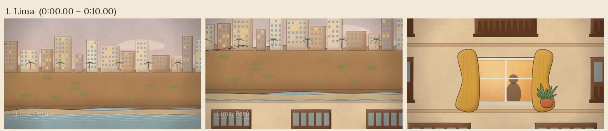

## 2. El regalo del hijo (`s02`)

- **Tiempo:** 0:09.10 – 0:22.10 (13.0 s)
- **Acontecimiento del libro:** Emilia ingresa el número de serie de la tarjeta que le regaló su hijo (pág. 10).
- **Ubicación:** Pasillo del departamento de Emilia: escritorio, computadora vieja de carcasa amarillenta, silla de mimbre.
- **Personajes:** Emilia.
- **Composición:** Plano medio lateral: Emilia sentada al escritorio, a la derecha el monitor. Paquete con celofán y sellos de Hong Kong; estante con cajas de regalos sin abrir.
- **Acción principal:** Abre el paquete, saca la tarjeta, se acomoda los anteojos, se toca la espalda dolorida y teclea el código con un dedo. Mira el reloj (casi las seis).
- **Emoción predominante:** Fastidio leve, concentración, resignación.
- **Cámara:** Leve travelling lateral y acercamiento al teclado.
- **Movimiento de personajes y objetos:** Manos, cabeza, parpadeo; péndulo del reloj.
- **Iluminación y paleta:** Lámpara cálida, luz de tarde.
- **Transición de entrada:** fundido encadenado (0.9 s)
- **Transición de salida:** Corte al monitor.
- **Sonido:** Tictac del reloj, celofán, teclas.
- **Función narrativa:** Presentar a Emilia, su soledad y el vínculo con un hijo lejano que le manda regalos.
- **Storyboard:** 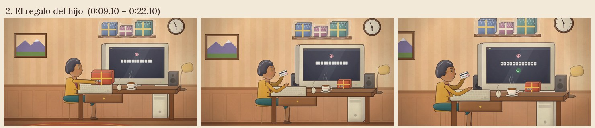

## 3. La conexión (`s03`)

- **Tiempo:** 0:22.10 – 0:35.10 (13.0 s)
- **Acontecimiento del libro:** «Conexión establecida», «despertar», la cocina desordenada, la chica de pelo mojado y el traductor (págs. 10–11).
- **Ubicación:** Lima (monitor) → Erfurt (vista de la cámara del kentuki).
- **Personajes:** Emilia, Eva.
- **Composición:** Sobre el hombro de Emilia; el monitor muestra un ícono de ojo. Al entrar en la pantalla: interfaz del controlador con íconos a los costados.
- **Acción principal:** Clic en el ojo; la cámara entra en la pantalla; cocina ajena con cervezas, platos y revistas; Eva se acerca con el pelo mojado y habla (franja amarilla del traductor). Emilia, frente a la pantalla, responde «yes» sin sonido.
- **Emoción predominante:** Desconcierto que se vuelve sonrisa.
- **Cámara:** Zoom continuo hacia el interior del monitor; contraplano desde la pantalla hacia Emilia.
- **Movimiento de personajes y objetos:** Eva se inclina hacia la cámara, gesticula; Emilia se acerca a la pantalla.
- **Iluminación y paleta:** Resplandor frío del monitor sobre la cara cálida de Emilia.
- **Transición de entrada:** corte
- **Transición de salida:** Corte a pantalla dividida.
- **Sonido:** Pitido de conexión, zumbido suave del kentuki.
- **Función narrativa:** Mostrar el mecanismo: la computadora de Emilia abre una ventana a otra casa.
- **Storyboard:** 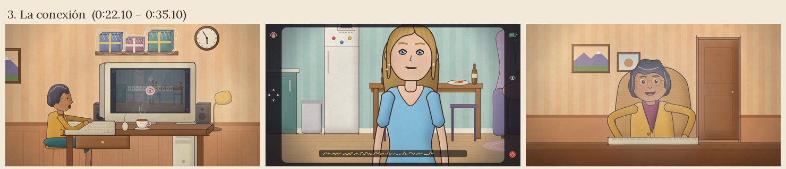

## 4. Cerrar los ojos (`s04`)

- **Tiempo:** 0:35.10 – 0:47.10 (12.0 s)
- **Acontecimiento del libro:** El juego de dormir/despertar y el dedo que toca la nariz (págs. 11–12).
- **Ubicación:** Pantalla dividida: Lima | Erfurt.
- **Personajes:** Emilia, Eva.
- **Composición:** Izquierda: Emilia al teclado (cálido). Derecha: vista del kentuki (frío) con la interfaz.
- **Acción principal:** Eva lee el manualito y se tapa los ojos; Emilia cierra los suyos de verdad y luego toca el ícono «dormir»: pantalla negra; Eva aplaude; «despertar»; Eva acerca el dedo a la lente; Emilia avanza y retrocede con las flechas.
- **Emoción predominante:** Juego, complicidad, sorpresa compartida.
- **Cámara:** Fija, con leves empujes.
- **Movimiento de personajes y objetos:** Manos sobre las flechas, la cámara del kentuki avanza y retrocede.
- **Iluminación y paleta:** Cálida / fría.
- **Transición de entrada:** corte
- **Transición de salida:** Corte.
- **Sonido:** Clics, ruedas del kentuki, aplauso suave.
- **Función narrativa:** Hacer visible que Emilia maneja un cuerpo a distancia.
- **Storyboard:** 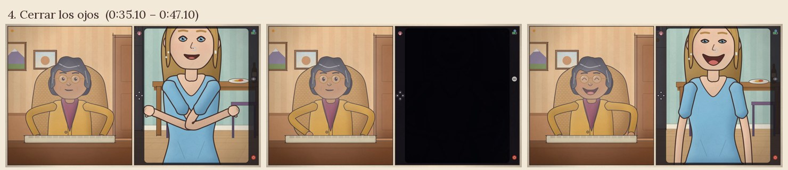

## 5. Eres una conejita (`s05`)

- **Tiempo:** 0:47.10 – 0:59.10 (12.0 s)
- **Acontecimiento del libro:** Eva le muestra la caja: Emilia es un kentuki conejo rosa y negro (pág. 12).
- **Ubicación:** Erfurt (vista del kentuki) → Lima → Erfurt (plano objetivo).
- **Personajes:** Eva, Emilia, la conejita.
- **Composición:** Eva sostiene la caja vacía con la ilustración de la conejita. Contraplano de Emilia. Plano objetivo: la conejita real sobre el piso de Eva.
- **Acción principal:** Emilia se lleva la mano a la cabeza como buscando orejas; corte por movimiento: la conejita inclina la cabeza igual que ella y avanza hacia Eva.
- **Emoción predominante:** Asombro, ternura, comicidad leve.
- **Cámara:** Acercamiento a la caja; corte por coincidencia de gesto.
- **Movimiento de personajes y objetos:** Orejas, ruedas, inclinación de cabeza sincronizada.
- **Iluminación y paleta:** Fría y luminosa en Erfurt.
- **Transición de entrada:** corte
- **Transición de salida:** Fundido.
- **Sonido:** Pequeño chillido del kentuki.
- **Función narrativa:** Establecer la dualidad central: persona en Lima / cuerpo de peluche en Erfurt.
- **Storyboard:** 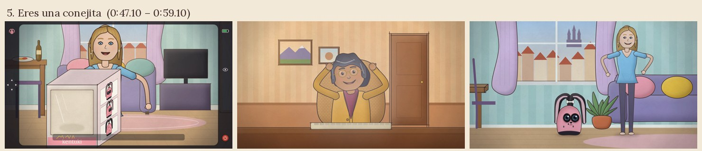

## 6. La ventana (`s06`)

- **Tiempo:** 0:58.30 – 1:10.30 (12.0 s)
- **Acontecimiento del libro:** La cucha fucsia; Eva la alza hacia la ventana: cúpulas, canales, luz roja; «Puedes llamarme Eva» (págs. 25–26).
- **Ubicación:** Erfurt: departamento de Eva y vista de la ciudad. Contraplano en Lima.
- **Personajes:** Eva, la conejita, Emilia.
- **Composición:** La conejita en la cucha fucsia de pintitas; Eva la levanta; vista subjetiva de la ciudad al atardecer; cara de Emilia iluminada de rojo.
- **Acción principal:** Eva alza el kentuki; la ciudad aparece; Emilia abre grandes los ojos; después mueve la conejita de un lado a otro pidiendo que la alcen otra vez.
- **Emoción predominante:** Maravilla: Emilia nunca salió del Perú.
- **Cámara:** Grúa ascendente subjetiva; paneo sobre los techos.
- **Movimiento de personajes y objetos:** Pájaros, agua del canal, cortina; ruedas que van y vienen.
- **Iluminación y paleta:** Atardecer rojo intenso.
- **Transición de entrada:** fundido encadenado (0.8 s)
- **Transición de salida:** Fundido encadenado al mapa.
- **Sonido:** Campanas lejanas, viento; la música se abre.
- **Función narrativa:** Ubicar el otro espacio. Rótulo «Erfurt, Alemania».
- **Storyboard:** 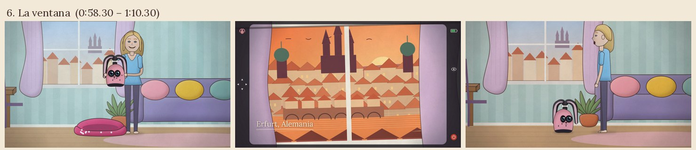

## 7. El mapa y las amigas (`s07`)

- **Tiempo:** 1:09.50 – 1:20.50 (11.0 s)
- **Acontecimiento del libro:** Emilia descubre que está en Erfurt; café de los jueves: Gloria entusiasmada, Inés horrorizada (págs. 26–27).
- **Ubicación:** Mapa ilustrado; café en Lima después de natación.
- **Personajes:** Emilia, Gloria, Inés.
- **Composición:** Mapa con un hilo punteado de Lima a Erfurt; luego mesa de café con tres amigas y bolsos de natación.
- **Acción principal:** El hilo cruza el océano; en el café Emilia cuenta, Gloria aplaude, Inés golpea la mesa con el índice.
- **Emoción predominante:** Orgullo, entusiasmo / desconfianza.
- **Cámara:** Travelling sobre el mapa; plano de conjunto con leve acercamiento.
- **Movimiento de personajes y objetos:** Gestos, tazas, vapor.
- **Iluminación y paleta:** Mañana clara en Lima.
- **Transición de entrada:** fundido encadenado (0.8 s)
- **Transición de salida:** Barrido de página.
- **Sonido:** Murmullo de café sin voces inteligibles: solo tazas y cucharitas.
- **Función narrativa:** Mostrar la distancia y las dos miradas sobre los kentukis (Gloria / Inés).
- **Storyboard:** 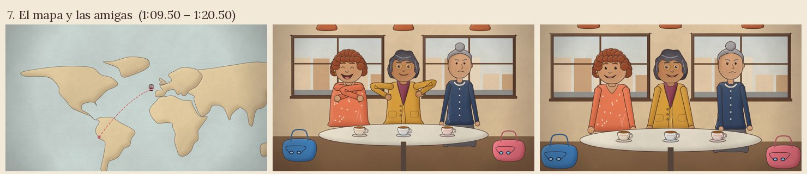

## 8. La rutina (`s08`)

- **Tiempo:** 1:19.50 – 1:34.50 (15.0 s)
- **Acontecimiento del libro:** Té después de lavar los platos; nota en la pata de la silla; juguetes; zapatos; cena con noticiero; escapadas bajo la mesa; Emilia ronronea en el súper (págs. 27–29).
- **Ubicación:** Lima y Erfurt alternados.
- **Personajes:** Emilia, Eva, la conejita.
- **Composición:** Montaje de viñetas encadenadas: té y computadora; nota fucsia en la pata de una silla; ovillo y ratoncito; sofá con la conejita entre almohadones frente a la tele; Eva persiguiéndola bajo la mesa.
- **Acción principal:** La conejita sigue a Eva, mira sus zapatos, se acurruca a su lado; Eva ríe atrapándola.
- **Emoción predominante:** Cariño creciente, alegría de «tener dos vidas».
- **Cámara:** Paneos cortos y encadenados.
- **Movimiento de personajes y objetos:** Ruedas, orejas, manos de Eva, vapor del té.
- **Iluminación y paleta:** Atardecer y noche cálidos en Erfurt.
- **Transición de entrada:** barrido de página (1.0 s)
- **Transición de salida:** Fundido.
- **Sonido:** Ronroneo del kentuki, tazas, tele muy baja sin voces.
- **Función narrativa:** Construir el vínculo afectivo entre Emilia y Eva.
- **Storyboard:** 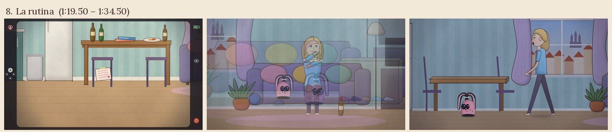

## 9. La batería (`s09`)

- **Tiempo:** 1:33.70 – 1:44.70 (11.0 s)
- **Acontecimiento del libro:** El hijo, por teléfono, le explica la batería y la «caducidad programada»; Eva la carga cada noche mientras Emilia duerme (págs. 29–30).
- **Ubicación:** Supermercado de Lima; Hong Kong; dormitorio de Emilia / living de Eva de noche.
- **Personajes:** Emilia, el hijo, Eva, la conejita.
- **Composición:** Emilia con el carrito y el teléfono; recuadro del hijo en Hong Kong; ícono de batería que baja. Pantalla dividida nocturna: Emilia dormida / Eva poniendo la conejita en el cargador.
- **Acción principal:** Emilia se alarma; luego comprende y sonríe; acomoda los duraznos arriba de las latas.
- **Emoción predominante:** Susto → ternura.
- **Cámara:** Plano medio; división de pantalla.
- **Movimiento de personajes y objetos:** Luz del cargador que pasa de roja a verde.
- **Iluminación y paleta:** Fluorescente del súper; noche azul.
- **Transición de entrada:** fundido encadenado (0.8 s)
- **Transición de salida:** Fundido a negro.
- **Sonido:** Teléfono, pitido de batería baja, respiración tranquila.
- **Función narrativa:** Mostrar el cuidado de Eva y la dependencia del kentuki. Rótulo «Hong Kong».
- **Storyboard:** 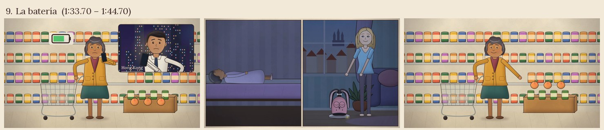

## 10. Cuatro pies (`s10`)

- **Tiempo:** 1:44.70 – 2:00.70 (16.0 s)
- **Acontecimiento del libro:** Cuatro pies descalzos; el hombre desnudo cocina; Eva se va a la ducha; el hombre la persigue y la levanta (págs. 61–62).
- **Ubicación:** Erfurt (vista del kentuki) / Lima de noche.
- **Personajes:** Emilia (camisón), Eva, el hombre (Klaus).
- **Composición:** Cámara tirada en la cucha: pies descalzos. La desnudez se sugiere: muebles en primer plano, toalla, encuadres cortados. Emilia se cierra el camisón.
- **Acción principal:** Emilia chilla; Eva la endereza y se va al baño; el hombre fríe huevos; la descubre, la persigue por el pasillo y la alza: su cara enorme llena la pantalla.
- **Emoción predominante:** Alarma, incomodidad, miedo.
- **Cámara:** Subjetiva baja, temblorosa en la persecución.
- **Movimiento de personajes y objetos:** Sartén, cáscaras de huevo, pasos, ruedas a máxima velocidad.
- **Iluminación y paleta:** La paleta se enfría; luz dura de cocina.
- **Transición de entrada:** fundido desde negro (1.0 s)
- **Transición de salida:** Corte.
- **Sonido:** Ducha, pasos, chillidos del kentuki; la música se vuelve tensa.
- **Función narrativa:** Primer conflicto: un intruso en la casa de Eva.
- **Storyboard:** 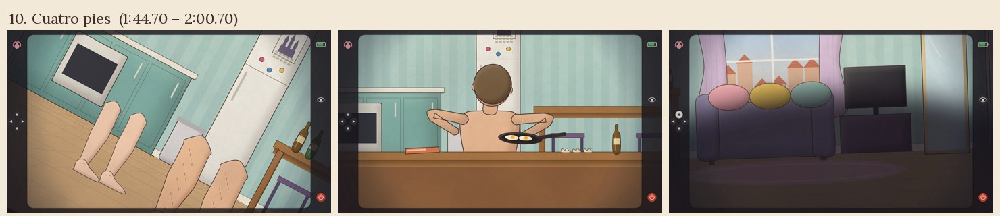

## 11. El robo y el agua (`s11`)

- **Tiempo:** 2:00.70 – 2:11.70 (11.0 s)
- **Acontecimiento del libro:** El hombre saca dinero de la billetera de Eva; la mete bajo el chorro de la canilla (pág. 62).
- **Ubicación:** Erfurt (vista del kentuki) / Lima.
- **Personajes:** Klaus, Emilia.
- **Composición:** Desde la mesa: manos que abren la billetera y sacan billetes. Luego la canilla y el chorro.
- **Acción principal:** Emilia chilla y gira en círculos; él la atrapa y la pone bajo el agua; gotas sobre la lente.
- **Emoción predominante:** Indignación, impotencia.
- **Cámara:** Subjetiva; la imagen se distorsiona con el agua.
- **Movimiento de personajes y objetos:** Billetes, chorro, salpicaduras.
- **Iluminación y paleta:** Fría.
- **Transición de entrada:** corte
- **Transición de salida:** Corte.
- **Sonido:** Agua, chillidos breves.
- **Función narrativa:** Mostrar la amenaza concreta y la impotencia del kentuki.
- **Storyboard:** 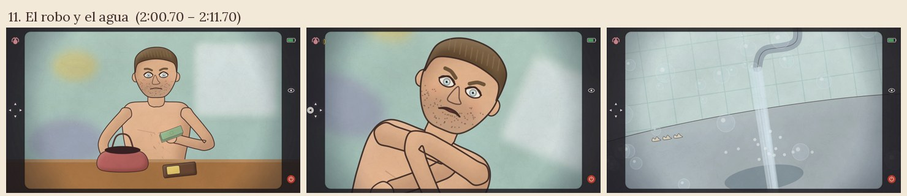

## 12. La cámara (`s12`)

- **Tiempo:** 2:11.70 – 2:24.70 (13.0 s)
- **Acontecimiento del libro:** Eva vuelve: solo hay que cuidarle los ojos, «ahí está la cámara»; Emilia se emociona; el hombre deja de sonreír y la mira a los ojos (págs. 62–63).
- **Ubicación:** Erfurt / Lima.
- **Personajes:** Eva (con toalla), Klaus, Emilia.
- **Composición:** Eva limpia con delicadeza los ojos de la conejita y los señala. Contraplano: Emilia con la mano en el pecho. Sofá: el hombre trae el plato y mira fijo a la cámara.
- **Acción principal:** Eva asiente señalando a la conejita; el hombre se queda serio; acercamiento lento a sus ojos claros.
- **Emoción predominante:** Emoción → inquietud.
- **Cámara:** Acercamiento lento final.
- **Movimiento de personajes y objetos:** Toalla, pelo húmedo.
- **Iluminación y paleta:** Contraste frío.
- **Transición de entrada:** corte
- **Transición de salida:** Fundido a negro.
- **Sonido:** Silencio con nota grave sostenida.
- **Función narrativa:** Eva reconoce que hay alguien adentro; el hombre también lo sabe ahora.
- **Storyboard:** 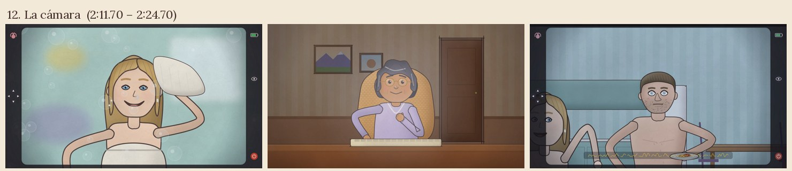

## 13. El kentuki del hijo (`s13`)

- **Tiempo:** 2:24.70 – 2:35.70 (11.0 s)
- **Acontecimiento del libro:** El hijo confiesa que tiene su propio kentuki; la mujer mayor le mandó tortas; Emilia siente celos: «tener» o «ser» (págs. 87–89).
- **Ubicación:** Comedor de Emilia (mesa de fórmica) / Hong Kong.
- **Personajes:** Emilia, el hijo, la mujer de las botas (en fotos).
- **Composición:** Emilia con el teléfono frente a la mesa; recuadro del hijo en su balcón con su kentuki y cajas de torta; en el teléfono, la foto de una mujer robusta con botas.
- **Acción principal:** Emilia escucha, mira la foto y baja la vista; sopla el té.
- **Emoción predominante:** Celos, tristeza contenida.
- **Cámara:** Plano medio con recuadro.
- **Movimiento de personajes y objetos:** Vapor del té, luces de Hong Kong.
- **Iluminación y paleta:** Lima fría de invierno; neón en Hong Kong.
- **Transición de entrada:** fundido desde negro (0.9 s)
- **Transición de salida:** Fundido.
- **Sonido:** Bip de mensaje.
- **Función narrativa:** Mostrar que el hijo es «amo» y Emilia «ser»; su soledad.
- **Storyboard:** 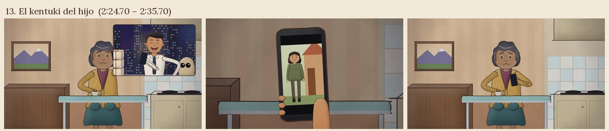

## 14. Klaus Berger (`s14`)

- **Tiempo:** 2:34.90 – 2:52.90 (18.0 s)
- **Acontecimiento del libro:** La camiseta roja con el número 4; Emilia lo busca en internet y le escribe; él responde y la llama; el insulto en el espejo; Eva la encierra en la bañera (págs. 117–120).
- **Ubicación:** Lima / Erfurt.
- **Personajes:** Emilia, Klaus, Eva.
- **Composición:** Klaus en el sofá con la camiseta roja n.º 4; la computadora de Emilia con fotos de jugadores; el teléfono con burbujas de mensaje ilegibles; el espejo con un garabato rojo agresivo a la altura de un kentuki; la bañera oscura.
- **Acción principal:** Emilia escribe, se arrepiente, el teléfono vibra: llama Klaus y ella lo deja boca abajo. En Erfurt, el espejo pintado; Eva llega, se enoja, lleva la conejita a la bañera y apaga la luz.
- **Emoción predominante:** Determinación → miedo → injusticia.
- **Cámara:** Montaje alterno, subjetivas.
- **Movimiento de personajes y objetos:** Lápiz labial en el piso, luz que se apaga.
- **Iluminación y paleta:** Cada vez más fría y contrastada.
- **Transición de entrada:** fundido encadenado (0.8 s)
- **Transición de salida:** Pantalla negra; corte con el timbre.
- **Sonido:** Campanitas del teléfono, vibración, silencio.
- **Función narrativa:** La intervención de Emilia sale mal y deteriora su relación con Eva.
- **Storyboard:** 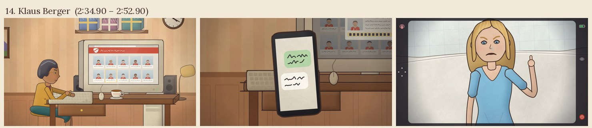

## 15. El regalo de Gloria (`s15`)

- **Tiempo:** 2:52.90 – 3:02.90 (10.0 s)
- **Acontecimiento del libro:** Gloria le regala un kentuki usado: una conejita idéntica (págs. 120–121).
- **Ubicación:** Comedor y entrada del departamento de Emilia.
- **Personajes:** Emilia, Gloria, la conejita de Lima.
- **Composición:** Gloria entra con una caja algo sucia; dentro, envuelta en un repasador, una conejita idéntica con los ojos cerrados.
- **Acción principal:** Emilia duda, sonríe sin querer; Gloria aplaude y enchufa el cargador junto a la puerta.
- **Emoción predominante:** Reticencia → ternura.
- **Cámara:** Plano de conjunto, acercamiento a la conejita dormida.
- **Movimiento de personajes y objetos:** Papel de regalo, repasador.
- **Iluminación y paleta:** Cálida de tarde.
- **Transición de entrada:** corte
- **Transición de salida:** Fundido a negro.
- **Sonido:** Timbre, papel.
- **Función narrativa:** Emilia pasa a «tener» un kentuki.
- **Storyboard:** 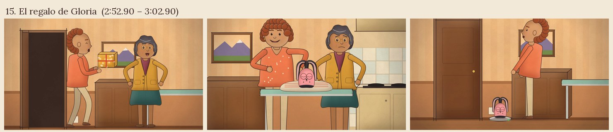

## 16. Las tres y diez (`s16`)

- **Tiempo:** 3:02.90 – 3:14.90 (12.0 s)
- **Acontecimiento del libro:** Se despierta de una pesadilla; a las 3:10 se conecta: Eva la perdonó y la puso a cargar; foto de Eva con su conejita en la heladera; Emilia le saca una foto a la pantalla (pág. 121).
- **Ubicación:** Dormitorio y pasillo de Emilia de noche / cocina de Eva de mañana.
- **Personajes:** Emilia, la conejita de Lima (dormida), Eva (en foto).
- **Composición:** Reloj en las 3:10; la conejita de Lima en su cargador con ojos cerrados; el monitor muestra la cocina de Eva iluminada por la mañana y la heladera con la foto.
- **Acción principal:** Emilia se sienta, acerca la mirada, se emociona y fotografía la pantalla con su teléfono.
- **Emoción predominante:** Alivio, ternura.
- **Cámara:** Acercamiento a la foto de la heladera.
- **Movimiento de personajes y objetos:** Luz del cargador, flash del teléfono.
- **Iluminación y paleta:** Noche azul en Lima / mañana dorada en Erfurt.
- **Transición de entrada:** fundido desde negro (0.9 s)
- **Transición de salida:** Barrido de página.
- **Sonido:** Reloj, pitido de carga, obturador.
- **Función narrativa:** Reconciliación: el vínculo con Eva parece restaurado.
- **Storyboard:** 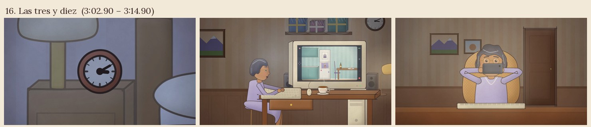

## 17. Ama y ser (`s17`)

- **Tiempo:** 3:13.90 – 3:26.90 (13.0 s)
- **Acontecimiento del libro:** Una semana de convivencia; fotos impresas por toda la casa; los llamados de Klaus; a las dos, las dos frente a la computadora (págs. 145–147).
- **Ubicación:** Casa de Emilia.
- **Personajes:** Emilia (bata y luego de día), la conejita de Lima (hebilla dorada).
- **Composición:** Heladera con la foto impresa en el centro; la conejita sigue a Emilia a la cocina; Emilia atiende el teléfono con los ojos cerrados mientras la conejita mira fijo el número encendido; a las dos de la tarde la sube al escritorio frente a la pantalla de Erfurt.
- **Acción principal:** Emilia le muestra Erfurt a su conejita.
- **Emoción predominante:** Armonía aparente, inquietud sutil.
- **Cámara:** Paneos suaves; plano detalle de los ojos del kentuki reflejando el teléfono.
- **Movimiento de personajes y objetos:** Ruedas, vapor del té, teléfono que vibra.
- **Iluminación y paleta:** Cálida, con un borde frío.
- **Transición de entrada:** barrido de página (1.0 s)
- **Transición de salida:** Fundido.
- **Sonido:** Ronroneo, vibración.
- **Función narrativa:** Emilia es «ama» y «ser» a la vez; la conejita observa (pista).
- **Storyboard:** 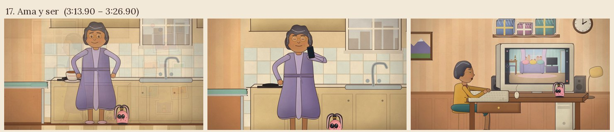

## 18. La llamada (`s18`)

- **Tiempo:** 3:26.10 – 3:42.10 (16.0 s)
- **Acontecimiento del libro:** Klaus recibe una llamada extraña y mira al kentuki; Eva vuelve de yoga; ven fotos en el teléfono; Eva sonríe perversa y llama a Emilia; la conejita le acerca el teléfono (págs. 147–149).
- **Ubicación:** Erfurt (pantalla) / Lima.
- **Personajes:** Klaus, Eva, Emilia, la conejita de Lima.
- **Composición:** En la pantalla: Klaus atento al teléfono junto a la ventana; Eva con la colchoneta; en el teléfono de Klaus, fotos de la casa de Emilia llena de fotos. Eva sentada en el piso mirando a la cámara. En Lima: la conejita empuja el teléfono hacia la mano de Emilia.
- **Acción principal:** Emilia atiende; franjas amarillas del traductor; su cara se transforma; vuelca el té y se pone de pie.
- **Emoción predominante:** Desconcierto → humillación.
- **Cámara:** Contraplanos cada vez más cerrados.
- **Movimiento de personajes y objetos:** Té derramado, teléfono.
- **Iluminación y paleta:** Fría, dura.
- **Transición de entrada:** fundido encadenado (0.8 s)
- **Transición de salida:** Corte.
- **Sonido:** Vibración, la música se reduce a un pulso grave.
- **Función narrativa:** Clímax: la intimidad de Emilia también fue espiada.
- **Storyboard:** 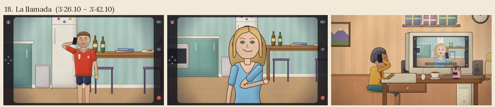

## 19. Conexión finalizada (`s19`)

- **Tiempo:** 3:42.10 – 3:52.10 (10.0 s)
- **Acontecimiento del libro:** Emilia apaga la pantalla, busca el botón rojo y anula la conexión: «Conexión finalizada» (pág. 149).
- **Ubicación:** Lima: escritorio del pasillo.
- **Personajes:** Emilia.
- **Composición:** La mano sobre el botón rojo; gran cartel rojo (solo ícono) en el monitor; las manos aferradas al respaldo de mimbre.
- **Acción principal:** Apaga, vuelve a prender, acepta la desconexión; queda inmóvil.
- **Emoción predominante:** Espanto, agotamiento.
- **Cámara:** Plano detalle y plano medio fijo.
- **Movimiento de personajes y objetos:** Mínimo: respiración, mimbre que cruje.
- **Iluminación y paleta:** Rojo del cartel sobre su cara.
- **Transición de entrada:** corte
- **Transición de salida:** Corte.
- **Sonido:** Clic; silencio.
- **Función narrativa:** Emilia corta el vínculo con Erfurt.
- **Storyboard:** 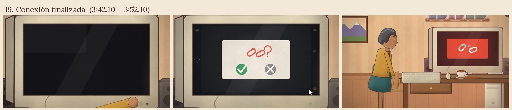

## 20. La pileta (`s20`)

- **Tiempo:** 3:52.10 – 4:08.10 (16.0 s)
- **Acontecimiento del libro:** La conejita la mira como juzgándola; Emilia la lleva a la cocina y la ahoga bajo el chorro hasta que la luz verde deja de titilar (pág. 149).
- **Ubicación:** Lima: escritorio y cocina.
- **Personajes:** Emilia, la conejita de Lima.
- **Composición:** La conejita en la otra punta del escritorio, ojos fijos. Emilia de espaldas en la pileta, la canilla abierta; solo se ve la lucecita verde y las ruedas. Plano final: la cocina, la canilla goteando, la heladera con la foto de Eva y su conejita.
- **Acción principal:** La alza de las orejas, abre la canilla, la sostiene bajo el agua; la luz verde titila y se apaga.
- **Emoción predominante:** Rencor, vacío.
- **Cámara:** Acercamiento lento; plano final fijo que se aleja.
- **Movimiento de personajes y objetos:** Agua, ruedas que giran y se detienen, luz verde.
- **Iluminación y paleta:** Fría y apagada.
- **Transición de entrada:** corte
- **Transición de salida:** Fundido a negro.
- **Sonido:** Agua, chillido ahogado breve, gota; silencio final.
- **Función narrativa:** Desenlace: Emilia repite con su conejita lo que Klaus le hizo a ella.
- **Storyboard:** 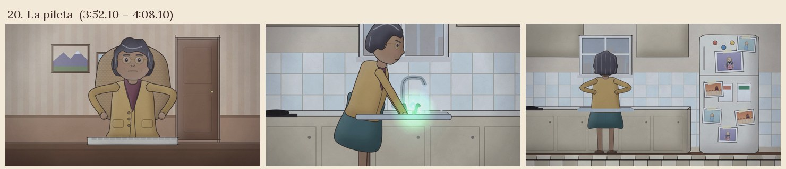
