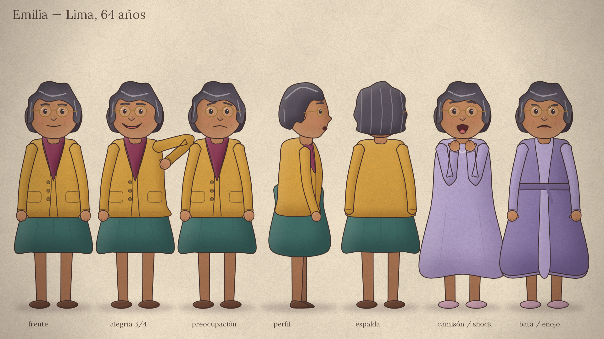
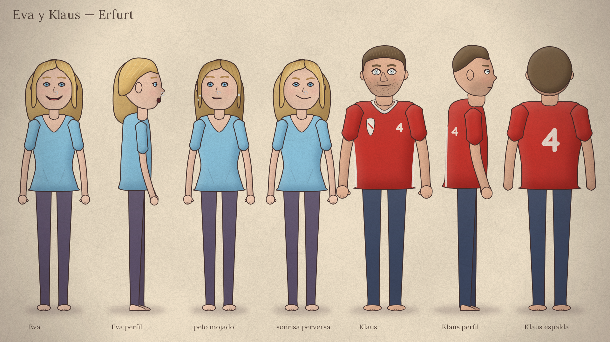
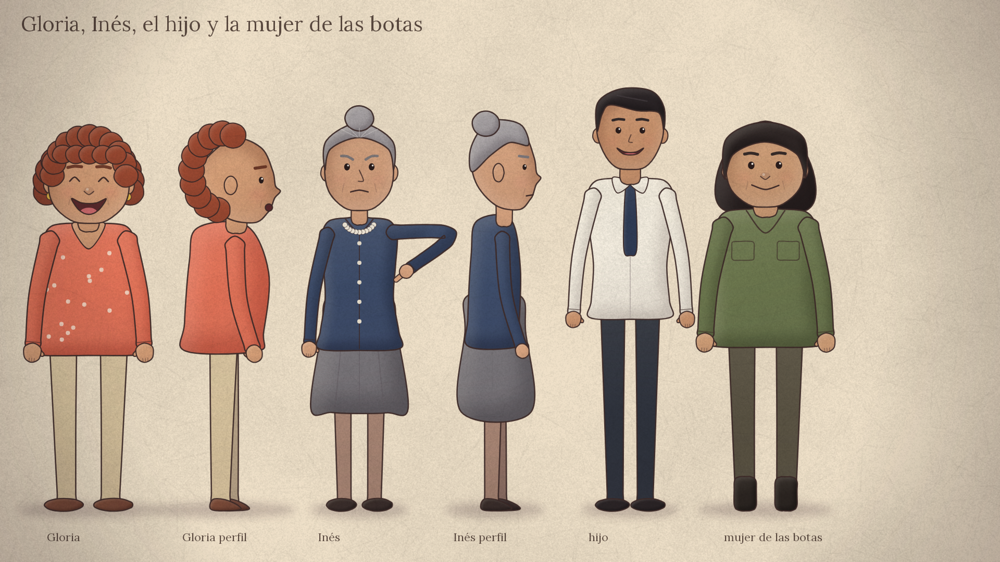
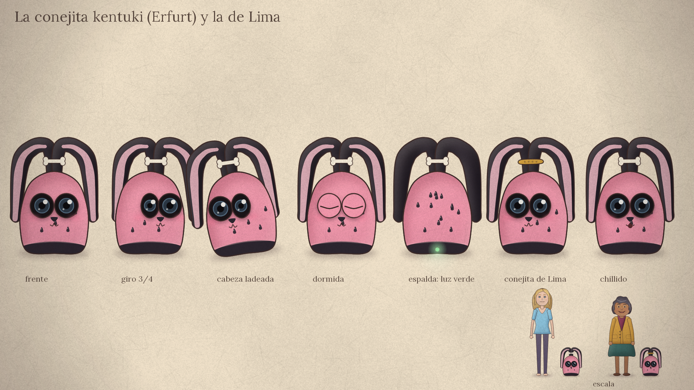

# Guía de estilo

Estética de **libro ilustrado que cobra vida**: dibujo 2D con trazos orgánicos (contornos sepia con un leve
temblor de mano), rellenos con degradé suave, sombras internas difusas, luces ambientales y una textura de
papel común a todos los planos. Las formas son simples y amables; la inquietud surge de los encuadres, las
miradas, las pantallas y el color, nunca de imágenes de terror.

Todo se dibuja por código (Skia) a partir de las mismas definiciones, por eso cada personaje se ve idéntico
en todas las escenas. Las hojas de modelo se regeneran con `python3 scripts/sheets.py`.

## 1. Emilia

- Jubilada de 64 años, de Lima. Piel morena cálida, pelo corto ondulado gris oscuro con mechas plateadas y
  anteojos redondos de marco dorado (siempre los lleva puestos).
- **De día:** saco tejido mostaza, blusa ciruela y falda verde azulada.
- **De noche:** camisón lila. **Bata:** lila oscuro con cinturón (escenas de la última semana).
- Silueta redondeada, hombros caídos; se sienta en una silla de mimbre frente a una computadora vieja de
  carcasa amarillenta.

## 2. Personajes secundarios

| Personaje | Rasgos fijos |
|---|---|
| **Eva** | Joven, pelo rubio claro (oscuro y en mechones cuando está mojado), ojos celestes, aro en la nariz, remera celeste y calzas violáceas, descalza en su casa. Con toalla cuando sale de la ducha. |
| **Klaus** | Corpulento, barba de días, ojos muy claros y demasiado grandes (lo único dibujado con mucho blanco: resulta inquietante). Camiseta roja con vivos blancos y el número 4. |
| **Gloria** | Rulos cobrizos, aros dorados, blusa coral con lunares: entusiasmo. |
| **Inés** | Rodete gris, saco azul abotonado, collar de perlas, ceño fruncido: desconfianza. |
| **El hijo** | Camisa blanca y corbata, pelo negro; siempre aparece en un recuadro nocturno de Hong Kong. |
| **La mujer de las botas** | Morocha robusta, ropa de trabajo verde, botas: solo aparece en una foto del teléfono. |

## 3. El kentuki de Emilia

- Peluche **rosa con semillas negras** («más parecido a una sandía que a un conejo»), cuerpo de pelota de
  rugby con la base plana, ojos saltones negros con lente (ahí está la cámara).
- Dos **orejas negras** largas unidas por una **hebilla con forma de hueso**: suben unos centímetros y caen a
  los lados.
- Base negra con ruedas ocultas y una **luz de conexión verde**.
- **La conejita de Lima** es idéntica, pero llega sin hebilla y Emilia le pone **su hebilla dorada**: así el
  espectador distingue cuál es cuál.
- El kentuki del hijo se dibuja como un kentuki beige **sin rasgos de especie**, porque el libro no la dice.

## 4. Espacios

| Lugar | Diseño |
|---|---|
| **Lima, exterior** | Acantilados de la Costa Verde, mar Pacífico, edificios con balcones de madera, cielo gris rosado. |
| **Casa de Emilia** | Paredes durazno con empapelado a rayas, zócalo de madera, pasillo con escritorio, reloj de pared, estante con regalos envueltos en celofán, comedor con mesa de fórmica verde agua, cocina con azulejos, heladera retro. |
| **Departamento de Eva (Erfurt)** | Paredes verde menta, cocina abierta, mesa con botellas y revistas, sofá lila con almohadones, espejo de pie, cucha fucsia con pintitas blancas. |
| **Erfurt, exterior** | Techos de tejas, agujas de la catedral, cúpulas, el canal y el puente con casas, atardecer rojo. |
| **Hong Kong** | Rascacielos nocturnos con luces de neón. |

## 5. Paleta y luz

| Clave | Uso | Colores |
|---|---|---|
| **Lima cálida** | Vida cotidiana de Emilia | ocre `#ebc49c`, terracota `#c58b66`, mostaza `#d6a347`, madera `#9b6a4b` |
| **Erfurt fría** | Todo lo que se ve a través del kentuki | menta `#bcd9d2`, celeste `#8cc6e6`, lila `#9a8ac0`, fucsia de Eva `#e0408a` |
| **Noche** | Escenas nocturnas | azul `#1a2550` multiplicado, resplandor frío del monitor sobre la cara |
| **Tensión** | Desde la llegada de Klaus | saturación reducida y desplazamiento hacia el azul (filtros `TENSE` y `COLD`) |
| **Desenlace** | La pileta | gris frío casi sin color; la única nota saturada es la luz verde que se apaga |

## 6. Gramática visual Lima / Erfurt

- **Lima** se muestra a cuadro completo y con luz cálida.
- **Erfurt visto por el kentuki** aparece siempre dentro del **controlador**: marco oscuro redondeado,
  flechas a la izquierda, ojo (despertar/dormir), batería y botón rojo a la derecha y una conejita rosa
  arriba (icono de identidad). La cámara está a la altura del piso.
- **Erfurt en plano objetivo** (para ver el cuerpo de la conejita) usa la paleta fría, sin controlador.
- La entrada al otro mundo se hace con un **zoom continuo hacia el interior del monitor**.
- **Pantalla dividida**: Lima a la izquierda, Erfurt a la derecha.
- **Sin texto explicativo**: el traductor son franjas amarillas con trazos ilegibles; los botones son íconos;
  los mensajes del teléfono son burbujas con garabatos; el insulto del espejo es un garabato rojo.
- **Rótulos** permitidos y respaldados por el libro: «Lima, Perú», «Erfurt, Alemania», «Hong Kong».

## 7. Proporciones, trazo y detalle

- Cabeza grande (≈23 % de la altura), extremidades que se afinan, manos de mitón.
- Contorno sepia `#3e2b2a` de 3,2 px a 1080p, nunca negro puro.
- Sombras internas difusas del lado opuesto a la luz; brillo suave del lado iluminado.
- Textura de papel y viñeta en todos los fotogramas.

## 8. Movimiento y transiciones

- Animación por *rig*: parpadeos, respiración, leve vaivén de cabeza, expresiones interpoladas, brazos con
  cinemática inversa, caminatas, ruedas y orejas del kentuki.
- Cámara discreta: paneos lentos, acercamientos, paralaje por capas; la cámara del kentuki tiembla al correr
  y se inclina cuando queda tirada.
- Transiciones: fundido encadenado, fundido a negro, barrido de página (montajes) y corte por coincidencia
  de gesto (Emilia se toca la cabeza → la conejita inclina la suya).
